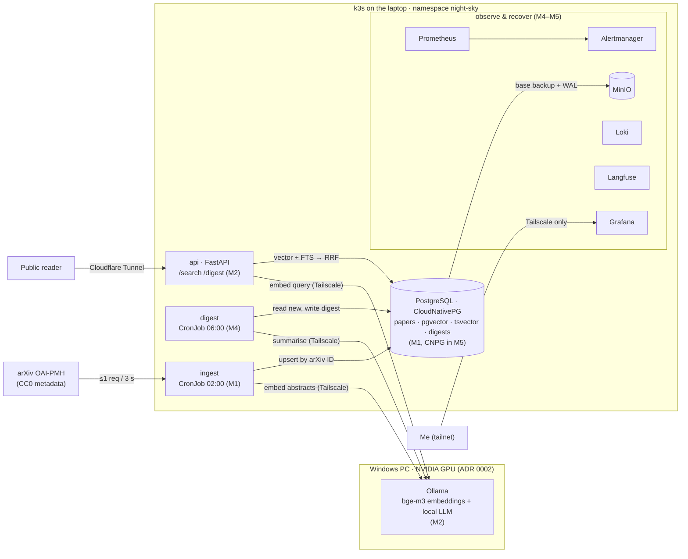
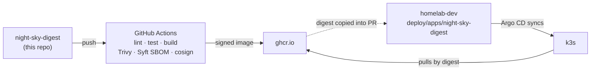

# Night Sky Digest

A nightly job pulls new arXiv **astro-ph** papers, indexes their abstracts, and writes a short morning
digest with citations. It also offers hybrid search over everything, in English, German, Russian and Arabic.

A learning project and portfolio piece. Not affiliated with or endorsed by arXiv.

## Status

M0 in progress. See [docs/plan.md](docs/plan.md) for milestones and [docs/architecture.md](docs/architecture.md)
for the design.

## Architecture

Target state at M5. Milestone tags show when each part arrives. Component details and open decisions: [docs/architecture.md](docs/architecture.md).

### Runtime



### Delivery



The app repo only publishes signed images. homelab-dev decides what runs.

## Layout

| Path | What lives there |
|---|---|
| src/ | Application code (Python 3.12, FastAPI). From M0. |
| tests/ | pytest. From M0. |
| docs/plan.md | Milestones M0–M6 and how to start |
| docs/architecture.md | Components, data flow, delivery path |
| docs/adr/ | Architecture decision records. Changing the default stack needs one. |
| docs/learning-ledger.md | Concepts introduced per milestone and how well I know them |
| docs/log.md | Short dated notes, including break-it labs |

Deployment manifests do **not** live here. They live in
[homelab-dev](https://github.com/tmukh/homelab-dev) under `deploy/apps/night-sky-digest/`, synced by Argo CD.

## Run locally

```
uv sync
uv run uvicorn night_sky_digest.api:app --reload   # http://127.0.0.1:8000/healthz
uv run pytest
uv run ruff check . && uv run ruff format --check .
```

## Data rules

- arXiv metadata (title, abstract, authors, categories, IDs) is CC0. That is all we store.
- No PDFs or full text, ever. We link to the abstract page.
- arXiv API / OAI-PMH: at most 1 request every 3 seconds, one connection.
- Backfill comes from the bulk metadata snapshot, not the API.
