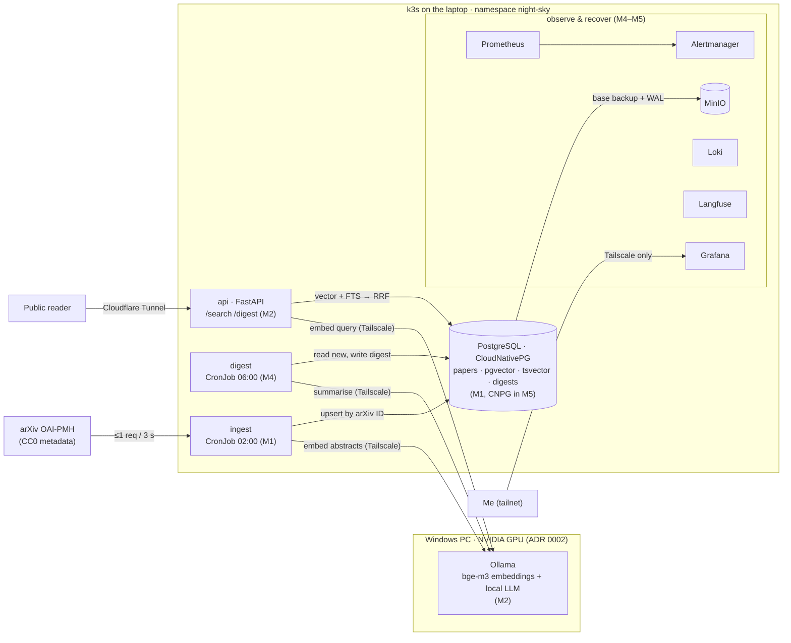
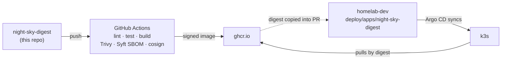

# Night Sky Digest

A nightly job pulls new arXiv **astro-ph** papers, indexes their abstracts, and writes a short morning
digest with citations. It also offers hybrid search over everything, in English, German, Russian and Arabic.

A learning project and portfolio piece. Not affiliated with or endorsed by arXiv.

## Status

M4 done: daily digest with faithfulness-checked citations, traced in self-hosted Langfuse. M3: hybrid search, nDCG@10 0.72 on 80 queries ([eval/](eval/README.md)). See [docs/plan.md](docs/plan.md) for milestones and [docs/architecture.md](docs/architecture.md)
for the design.

## Architecture

Target state at M5. Milestone tags show when each part arrives. Component details and open decisions: [docs/architecture.md](docs/architecture.md).

### Runtime



### Delivery



The app repo only publishes signed images. homelab-dev decides what runs.

## Layout

| Path | What lives there |
|---|---|
| src/ | Application code (Python 3.12, FastAPI). From M0. |
| tests/ | pytest. From M0. |
| docs/plan.md | Milestones M0–M6 and how to start |
| docs/architecture.md | Components, data flow, delivery path |
| docs/adr/ | Architecture decision records. Changing the default stack needs one. |
| docs/learning-ledger.md | Concepts introduced per milestone and how well I know them |
| docs/log.md | Short dated notes, including break-it labs |

Deployment manifests do **not** live here. They live in
[homelab-dev](https://github.com/tmukh/homelab-dev) under `deploy/apps/night-sky-digest/`, synced by Argo CD.

## Run locally

```
uv sync
uv run uvicorn night_sky_digest.api:app --reload   # http://127.0.0.1:8000/healthz
uv run pytest
uv run ruff check . && uv run ruff format --check .
```

## Verify an image

Images are signed in CI with keyless cosign; the signature is tied to this repo's workflow on `main`.

```
IMAGE=ghcr.io/tmukh/night-sky-digest@sha256:<digest>
ID=https://github.com/tmukh/night-sky-digest/.github/workflows/image.yml@refs/heads/main
ISSUER=https://token.actions.githubusercontent.com
cosign verify --certificate-identity "$ID" --certificate-oidc-issuer "$ISSUER" "$IMAGE"
cosign verify-attestation --type spdxjson --certificate-identity "$ID" --certificate-oidc-issuer "$ISSUER" "$IMAGE"
```

## Ingest

```
uv run python -m night_sky_digest migrate                                # apply schema migrations
uv run python -m night_sky_digest ingest --backfill-from 2024-10-10      # first run only
uv run python -m night_sky_digest ingest                                 # afterwards: since the checkpoint
uv run python -m night_sky_digest embed                                  # embed new/changed papers (Ollama, bge-m3)
uv run python -m night_sky_digest digest [--date 2026-10-09]             # digest of one announcement day
```

`DATABASE_URL` and `OLLAMA_URL` (default `http://localhost:11434`) come from the environment or `.env`.
`DIGEST_MODEL` picks the digest writer (default `qwen2.5:7b`). With `LANGFUSE_PUBLIC_KEY`, `LANGFUSE_SECRET_KEY`
and `LANGFUSE_BASE_URL` set, every digest run is traced in Langfuse; without them tracing is off.
Runs are recorded in `harvest_runs`.

## Search

```
uv run uvicorn night_sky_digest.api:app --reload
```

- `GET /search?q=fast+radio+burst+localisation&k=10&mode=hybrid` (or `lexical` / `semantic`)
- Each hit carries `lexical_rank` and `semantic_rank`, so you can see why it ranked where it did.
- Interactive API docs at `/docs`.

## Digest

One LLM call per astro-ph subfield turns the day's new papers into 1–4 highlights, each citing arXiv IDs.
A faithfulness check rejects any citation of a paper the model wasn't given; the problems go back to the
model for up to two retries, then unfaithful highlights are dropped and counted. "New" means announced
that day with an ID from that month or the previous one (arXiv's `created` field is the latest version's
date). Read it at `GET /digest/latest`, `/digest/{day}` or `/digest/{day}.md`.

## Website

Server-rendered with Jinja2, no JavaScript: `/` shows the latest digest (with links to earlier days at
`/days/{day}`), `/find?q=` searches and marks each hit as found by keyword, meaning or both. Public at
https://digest.takodana.dev.

## Metrics

`GET /metrics` (Prometheus): request latency and status per route (`night_sky_http_request_duration_seconds`,
search SLO), `night_sky_search_degraded_total` (hybrid search answered lexical-only because Ollama was
unreachable), and pipeline state read from Postgres at scrape time: last successful ingest and digest,
papers indexed, tokens per digest, and on-time digest days over 28 days for the freshness SLO
(`NIGHT_SKY_SLO_START` sets the first day that counts).

## Data rules

- arXiv metadata (title, abstract, authors, categories, IDs) is CC0. That is all we store.
- No PDFs or full text, ever. We link to the abstract page.
- arXiv API / OAI-PMH: at most 1 request every 3 seconds, one connection.
- Backfill comes from the bulk metadata snapshot, not the API.
