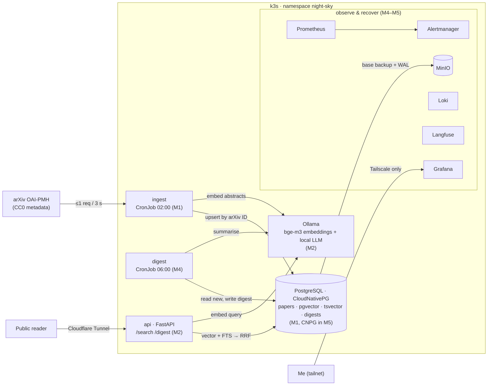
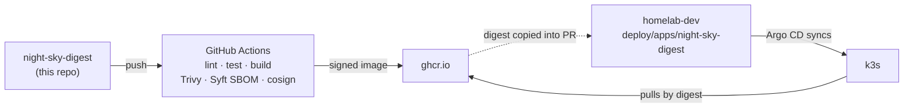

# Architecture

Target state (M5). Each component is tagged with the milestone it arrives in.

## Runtime

Three workloads, two shared services:

- **ingest** (CronJob): OAI-PMH `ListRecords` for `physics:astro-ph`, following resumption tokens, one
  request per 3 s. Upserts on arXiv ID, so re-running a night is harmless (idempotent). Stores the last
  successful `from` date, so a crash resumes instead of restarting (resumable).
- **digest** (CronJob): picks the day's new papers, asks the LLM for a short digest, rejects any output that
  cites an ID not in the retrieved set (faithfulness check), stores it.
- **api** (Deployment): `/search` runs a pgvector nearest-neighbour query and a Postgres full-text query,
  then merges the two ranked lists with reciprocal-rank fusion. `/digest` serves the latest digest.
  This is the only thing exposed through the Cloudflare tunnel.
- **PostgreSQL + pgvector**: one database for metadata, embeddings, the lexical index and digests.
- **Ollama**: multilingual embeddings (bge-m3) and the summary LLM. A hosted LLM API is optional behind a flag.

## Delivery

Same pattern as application-tracker: the app repo publishes images, homelab-dev decides what runs.

## Open decisions

| Question | Decide by | Notes |
|---|---|---|
| Where Ollama runs: in-cluster on CPU, or on the Windows host GPU reached from k3s | M2 | bge-m3 on CPU is fine for nightly batches; the LLM summary is the slow part. ADR 0002. |
| Embedding dimension and index type (HNSW vs IVFFlat) | M2 | bge-m3 dense = 1024 dims. |
| Backfill window and source (Kaggle arXiv snapshot vs OAI-PMH) | M1 | ~2 years of astro-ph is roughly 30k papers. |
| How the frozen eval snapshot gets into CI (pg_dump artifact vs fixture) | M3 | Must be small and deterministic. |
